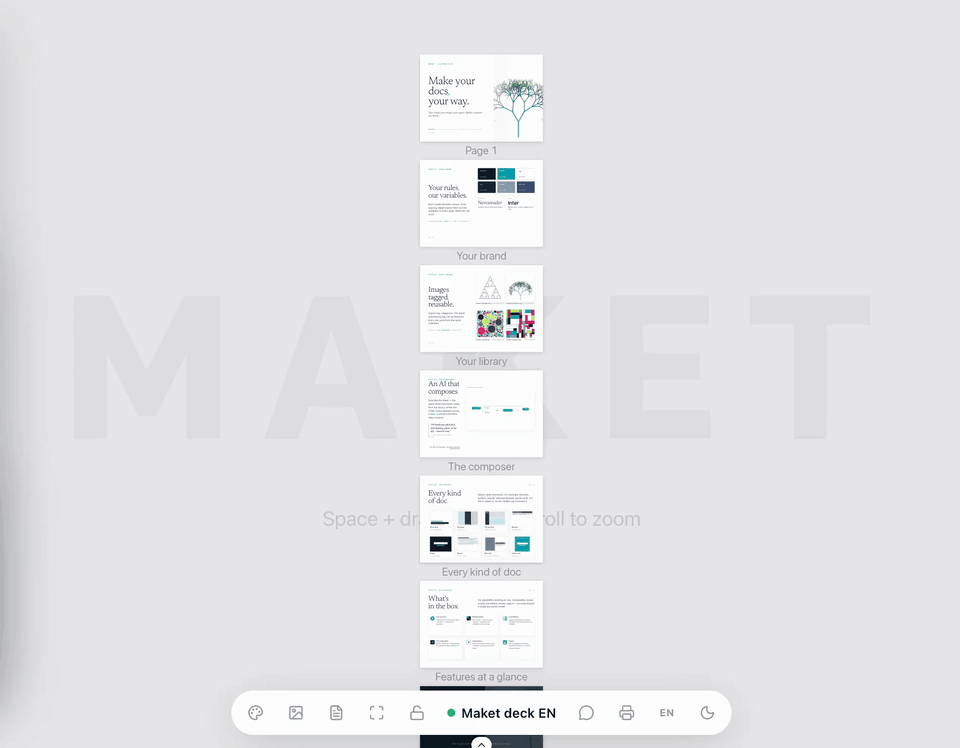

# Maket

**Create visual documents with your AI assistant.** Maket gives Claude, Codex, Gemini, and other MCP clients an HTML/CSS canvas with live preview. Compose a one-off design, bind a template to typed rows for mail merge, or attach validated document-owned state so native HTML controls and agent updates keep a living document current. Export finished output to PDF or hand it off to Gmail as a draft.

[](https://www.npmjs.com/package/@ng-galien/maket)
[](https://www.npmjs.com/package/@ng-galien/maket)
[](LICENSE)
[](https://nodejs.org/)
[](https://modelcontextprotocol.io/)
[](https://glama.ai/mcp/servers/ng-galien/maket)
[](https://github.com/ng-galien/maket/actions/workflows/ci.yml)
[](https://github.com/ng-galien/maket/actions/workflows/ci.yml)
[](#contributing)

**[Visit the Maket website →](https://ng-galien.github.io/maket/)**

<p align="center">
  
</p>

<p align="center">
  <em>60 seconds · charte → library → data → AI composition → every kind of doc → export.</em>
</p>

---

## Install Maket App

Maket App is the default way to run Maket. It includes the interface, server,
runtime, and agent setup — Node.js is not required.

| Platform | Installer |
|---|---|
| **macOS Apple Silicon** | `Maket-macOS-arm64.dmg` |
| **macOS Intel** | `Maket-macOS-x64.dmg` |
| **Windows x64** | `Maket-Windows-x64-Setup.exe` |
| **Linux x64** | `Maket-Linux-x64.deb` or `Maket-Linux-x64.rpm` |

[Download the newest snapshot](https://github.com/ng-galien/maket/actions/workflows/desktop-snapshot.yml)
to test Maket App now. Snapshot installers are unsigned, built from `main`, and
retained for 14 days. The same unsigned installers for macOS and Windows, plus
Linux packages, appear on the
[latest release](https://github.com/ng-galien/maket/releases/latest).

Open the installer, launch **Maket**, then follow the first-run agent setup.

Need a headless server, CI installation, or browser-only deployment? Jump to
[Maket Server via npm](#option-b--maket-server-via-npm-advanced).

## Why Maket

Your AI assistant is good at writing. But design is about space, hierarchy, and rhythm — and that happens in layout, not prose. Maket adds a real canvas, reusable visual resources, and two distinct data models: collections produce repeated variants from ordered rows, while document state keeps one document synchronized with its own validated, revisioned data.

## Features

- **Live preview** — Changes appear in your browser the instant the AI writes them. Use **Annotate** in the detail document toolbar (or connected Reader) to select an element and save feedback for the agent; turn it off to resume navigation.
- **HTML/CSS canvas** — Pages are real HTML sized in mm. No lock-in to a proprietary format.
- **Brand chartes** — Define design tokens (colors, fonts, spacing, shadows) once; Maket enforces them during composition.
- **Image library** — Drop images in, tag them, the AI picks the right one for the brief.
- **Data-driven collections** — Define typed fields with JSON Schema, paste or edit ordered rows, bind a page to placeholders such as `{{ product_name }}`, preview one row or the full series, and render one output page per row.
- **Living documents** — Attach a JSON Schema and state snapshot to one document, render `{{ state.* }}` values, edit supported fields through bound checkbox, text, select, and button controls, and retain immutable revisions for history and restore.
- **PDF export** — Print-ready output via headless Chromium.
- **Gmail drafts** — Compose an email document and hand it off to Gmail as a draft; you review and send yourself.
- **Paper & screen formats** — A2–A8, DESKTOP/TABLET/MOBILE aspect ratios, and AUTO pages with a defined width and content-driven height.
- **Agent skills included** — Three skills (`maket`, `maket-charte`, `maket-review`) that teach the AI assistant how to design, brand, and review documents.

## What it looks like

```
You    — fais-moi un flyer A5 pour un concert jazz dimanche soir, ambiance feutrée

AI     — maket_doc new doc="Jazz flyer" format=A5 orientation=portrait
         maket_charte view name="Smoky Club"
         maket_html set doc="Jazz flyer" page=1 context_token=...
         → Live preview opens. Warm amber on deep navy, serif display for
           the headline, fine sans for the venue details.

You    — (clicks the date on the preview) "rends-la plus grosse"

AI     — maket_workspace list_messages → sees your note
         maket_html patch doc="Jazz flyer" ops=[...]
         → Date scales up, hierarchy re-balanced.

You    — parfait, exporte

AI     — maket_pdf doc="Jazz flyer"
         → ~/.maket/exports/jazz-flyer.pdf
```

## Data-driven documents

Collections turn a page into a reusable template for product labels, event badges, personalized flyers, certificates, catalog pages, or any other repeated document. Each collection owns a **JSON Schema** and a set of ordered rows. Bind it to a page, place typed values in the HTML with `{{ field_name }}`, and Maket renders one variant per row.

The Collections workspace and `maket_collection` tool both support schema changes, row insertion/update/delete, paste-oriented tabular editing, and validation feedback. Maket validates the schema, every row, and every placeholder before rendering. In the preview you can keep the raw template visible, inspect one selected row, or display the complete generated series; print and PDF output expand the bound page across all rows.

```text
You    — crée une série d'étiquettes produit avec le nom et le prix

AI     — maket_doc new doc="Product labels" format=A6 orientation=portrait
         maket_collection action=create name=products
           schema='{"type":"object","properties":{"product_name":{"type":"string"},"price":{"type":"string"}},"required":["product_name","price"]}'
         maket_collection action=add_row name=products
           data='{"product_name":"Earl Grey","price":"12 €"}'
         maket_collection action=add_row name=products
           data='{"product_name":"Sencha","price":"14 €"}'
         maket_collection action=bind doc="Product labels" page=1 name=products
         maket_html set doc="Product labels" page=1
           html='<article data-id="label"><h1 data-id="name">{{ product_name }}</h1><p data-id="price">{{ price }}</p></article>'
         → The preview can show the template, either product, or both generated labels.

You    — exporte toute la série

AI     — maket_pdf doc="Product labels"
         → One PDF page per collection row.
```

## Living documents

Document state is for a single evolving artifact: a checklist, status board, form, or report whose current values belong to that document. `maket_state` initializes a JSON Schema and data snapshot, validates every update, requires the current revision for mutations, and records each accepted change as a complete immutable revision. Updates re-render the existing pages; they do not create mail-merge variants.

A page can use HTML, JSON Forms, or HTML embedding its current JSON Forms template at `<!--maket-json-form-->`. A hand-authored HTML template uses the supported Mustache subset for display and explicit `data-maket-bind` attributes for editing. A JSON Forms template is set with `maket_page action=set_form`; its optional UI schema controls layout while the document-state JSON Schema supplies fields and choices. Maket renders both formats with native controls through the same state owner. The same current values render passively in snapshots, print, and PDF output.

For sequential questions, keep the subject and answer-history Mustache list in HTML, place exactly one `<!--maket-json-form-->` inside a static block container outside Mustache sections, and call `maket_page action=set_form` for each question. Changing the form preserves the HTML and document state. The embedded form adapts to its container.

JSON Forms styling is renderer-owned: attach a charte to apply its text, background, surface, border, accent, muted, and font tokens. The UI schema controls structure and presentation options, not arbitrary CSS.

```html
<h1 data-id="title">{{ state.title }}</h1>
<label data-id="done-label">
  <input data-id="done-input" type="checkbox" data-maket-bind="state.done">
  Done
</label>
<input data-id="owner-input" type="text" data-maket-bind="state.owner">
```

Use `maket_state action=init` to attach the initial schema and data, then `get`, `patch` or `update`, `history`, `revision`, and `restore` to manage it. Portable `.maket` bundles carry the current schema, data snapshot, and template format; importing one starts a fresh local history at revision 1 rather than copying prior revisions. See the [document-state template contract](docs/document-state-bindings.md) for the exact template, schema, control, and concurrency rules.

## Structured Workspaces

A Structured Workspace groups one or more named collections whose detail views are real, persistent living documents. Its data schema validates every item and may use `oneOf`; its representation schema gives each collection a global template and binds concrete schema paths to compact and detail template documents. Every collection has its `identity`, a JSON Pointer to a required string or number property of its items, `/id` by default when the data schema requires an `id` property (so a Workspace is still created from a data schema alone); the value of that property, as a string, is the item id everywhere (documents, annotations, pins, cursors, MCP calls), unique across the whole Workspace, all collections included, and Maket never generates one. Adding an item without that value, or with a value another item of the Workspace already bears, is refused naming the field or the existing item; an update cannot change it, and the generated detail form shows it read-only. Adding an item stores its data at revision 1 and gives it the next value of its collection's insertion sequence, a stored counter that only grows and is never reused. A collection may declare `sortBy` (a JSON Pointer into the item data, such as `/place`) with `sortDirection` `ascending` or `descending`, and its index then orders the cards of each group by that value and equal values by item id, re-sorted whenever an item or the definition changes, while a collection without it keeps insertion order. Workspaces created before declared identities were migrated once: each collection without identity gained an `id` property holding the former item id (or `itemId` when an `id` property held other values), so documents, annotations and pins kept resolving; a Workspace read from a bundle written before identities gets the same declaration at import.

Items are served to the index, the workspace views and the MCP answers through a data source interface (`ItemSource`, in `packages/server/src/services/item-sources/`): it lists item summaries in index order with a cursor and a total, reads one item with its revision, and writes at an expected revision. Its first implementation is Maket's own storage, where each item is one row of `structured_workspace_items` holding its data and revision. The source holds the data and the document holds the rendering: an item's document is created only when the item is first opened, with an id derived from the Workspace and item ids and the name given at `add_item`, which stays reserved for it whether or not it was opened (`maket_doc` and the document commands refuse it); item documents are not loaded when Maket starts but on demand, and stay loaded once opened; an export creates the documents it lacks and removes them once the bundle is written; an item document stays out of the Documents library and document search, and its state is a mirror of the row, refreshed on open and after each write. A `.maket` bundle carries each Workspace definition with its item rows (identity, data, revision) and the item documents it holds rendered, never item data in document states; an import rebuilds the rows, and an export reports every item whose document it leaves out. The detail form, `maket_state` and `update_item` all write through the source at the row revision, so a stale write is refused with the current data. The item history is not kept in the document state. The list is read by cursor: a query (free text over the collection `searchFields`, by default every text property, ignoring case and accents, filters, sort and a batch size, `indexPageSize` 50 by default and at most 500) answers one batch with an opaque `next` cursor, the total and the item count of each group, pushed down to one SQLite query; a new query restarts from the first item and there is no page number. The cursor is the sort value and the item id under a sort, the insertion sequence and the item id otherwise: no item that existed before the first batch and kept its sort value is skipped or repeated, while an item whose sort value changes during paging may move across the cursor. `check` and `update_definition` read the items by batches through the source, and `update_definition` reports the first breaches of a new definition. The server holds the current window of each collection, shared by every client and the agent, and re-reads it when the source changes: the index document renders that window (the first batch, then each batch loaded after it) under group headers that count the whole query, the index pane offers a search bar and a load-more control, the client keeps only the window and light workspace views (item counts and pinned items, never the item data), and `maket_structured_workspace action=view` answers one batch of the window with its cursor.

An agent builds a Workspace along one of three paths, documented step by step in `maket_learn action=topic topic=structured-workspaces`: from a data schema alone, where Maket writes the index, detail and card templates and an edit form itself; with the template HTML and form given inline in the `create` call, where Maket still creates and names the template documents in the Workspace category; or by naming template documents created beforehand, which binding moves out of the Documents library. `create` and `update_definition` refuse a definition with errors, one line per error with its collection, path and fix, unless `allow_incomplete` is set, and `maket_structured_workspace action=check` returns a ready or not-ready verdict with every finding, its correction and the next call, without changing anything.

The Workspace sidebar lists collection indexes and pinned items only; other items are opened from their index, and templates remain available in the Workspace actions menu. The icon-only display toggle in the general toolbar switches between a single document (Square) and list/detail (PanelLeft); there is no separate view-choice toolbar. Opening another item replaces the current detail pane; closing the item returns to its index. Both panes open in Reader with ordinary scrolling; a narrow AUTO list holds the batches loaded so far on one continuous page, and its load-more control appends the next batch. Explicit Canvas navigation enables independent wheel zoom and drag pan, and the header percentage resets the fit. A draggable, keyboard-accessible separator starts at 28/72 and adjusts the widths. On narrow windows the library opens as an overlay, preserving readable document widths and its pin preference. Item pins persist and can be removed from the sidebar. This browsing surface keeps live document forms interactive; template authoring continues on the canvas.

Reader shows the focused document with titles above each page of a multi-page document. Entering Reader from collection browsing preserves the current page; switching between its open index and item keeps their navigation context. Closing Reader restores the originating document and page and the single/split layout. Passive page visibility in either split pane remembers its own position without taking focus from the other pane. Closing all documents cancels pending explicit openings, so late server replies cannot reopen the workspace.

Template-controlled pages stay synchronized across every existing item and index document and are edited at the template. Pages added to one instance remain editable and survive template synchronization. `maket_structured_workspace` exposes workspace creation, revision-checked schema and template-binding changes, item creation and mutation, deletion, inspection, and explicit template synchronization through MCP.

## Installation details

Pick the row that matches your machine.

| Platform | Recommended | What you get |
|---|---|---|
| **macOS** (Apple Silicon or Intel) | [Maket App](#option-a--maket-app) — `.dmg` | Native window, embedded server, agent setup on first launch |
| **Windows** x64 | [Maket App](#option-a--maket-app) — `.exe` installer | Same |
| **Linux** x64 | [Maket App](#option-a--maket-app) — `.deb` or `.rpm` | Native window and embedded server; manual updates |

### Option A — Maket App

Download the installer from the [latest release](https://github.com/ng-galien/maket/releases/latest),
using the filename for your platform:

- **macOS Apple Silicon** — `Maket-macOS-arm64.dmg`
- **macOS Intel** — `Maket-macOS-x64.dmg`
- **Windows x64** — `Maket-Windows-x64-Setup.exe`
- **Linux x64** — `Maket-Linux-x64.deb` or `Maket-Linux-x64.rpm`

On macOS, open the `.dmg` and drag **Maket** onto **Applications**. On Windows,
run the installer; it sets up the Start menu entry and a desktop shortcut. The
macOS and Windows installers are currently unsigned. On macOS, if Gatekeeper
blocks the first launch, Control-click **Maket**, choose **Open**, then confirm
once. Windows may show a SmartScreen warning that must be confirmed manually.
On Linux, install the package with your distribution's package manager; updates
are downloaded manually. For a version not yet released, use the Linux snapshot
artifact from the matching `main` commit. See [Linux installation and sandbox diagnostics](docs/linux-desktop.md).

Maket App carries its own runtime — **you do not need Node.js installed**. On
first launch it offers to wire the AI clients it finds on your machine (Claude
Code, Codex, Gemini) to its embedded server, and it can install the bundled
connector for Claude Desktop. The embedded server listens on `127.0.0.1:24843`.

If a Maket server is already running from a previous npm install, the
application says so and offers to stop it and take over — nothing is killed
without your confirmation.

The window is not the only way in: the **Maket** menu has *Ouvrir dans le
navigateur*, which serves the same workspace at `http://127.0.0.1:24843` in any
browser on that machine. Only that machine — the server never binds a public
interface, so nothing is exposed to your network.

Updates are checked automatically and installed on your confirmation. The
**Candidate** channel in Settings opts you into validation builds.

### Option B — Maket Server via npm (advanced)

```bash
# Install Maket and its compatible headless Chromium
npm install -g --allow-scripts=puppeteer @ng-galien/maket

# Wire Maket into your AI client (drop --apply for a dry run)
maket install claude --apply
maket install codex  --apply
maket install gemini --apply

# Start the local server and open the preview
maket start
maket open
```

In Chrome, Edge, or another supporting browser, use **Install Maket** in the
browser UI or in Maket Settings to keep the workspace in its own application
window. This PWA uses the same local server: it does not start, stop, or update
the native process, so `maket start`, `maket stop`, and `maket update` remain
explicit terminal commands.

The explicit `--allow-scripts=puppeteer` is required by npm 11+'s dependency
script policy. It lets Puppeteer download the exact headless Chromium build
declared by the installed Maket release; no browser version is hard-coded by
Maket itself. Run `maket doctor` after installation to prove that Chromium can
actually launch, the data directory is writable, and the MCP server responds.

The CLI registers the absolute local Node runtime and installed Maket entry in an `mcpServers.maket` entry in `~/.claude.json` (or runs `claude mcp add` if the Claude Code CLI is installed), a `[mcp_servers.maket]` section in `~/.codex/config.toml`, or an `mcpServers.maket` entry in `~/.gemini/settings.json`. This standard command-plus-arguments form does not depend on the GUI application's shell `PATH`. Re-run `maket install <client> --apply` after moving the Node or Maket installation. Without arguments, the Maket entry runs as a stdio MCP bridge — that's the form Claude Desktop, Codex, Gemini, and other MCP clients invoke automatically.

Daemon controls: `maket status`, `maket logs [--bridge]`, `maket stop`, `maket restart`. Diagnostics: `maket doctor`, `maket config`. Upgrade: `maket update [--check]`. Undo install: `maket uninstall <claude|codex|gemini> --apply`. Use `--scope=project` on `install claude` to write `<cwd>/.mcp.json` instead of the user-scope file. Global flags `--data-dir`, `--port`, `--host` override the matching `MAKET_*` env var on any command.

### Option C — Clone and hack on it

```bash
git clone https://github.com/ng-galien/maket.git
cd maket
npm install
npm run dev
```

Starts the development server on `:24844` and Vite HMR on `:5173`. The included `.mcp.json` points an MCP client opened in the project at `http://localhost:24844/mcp`. Port `:24843` is reserved for the installed desktop application.

### Code quality and architecture rules

Maket uses `code-moniker` for structural rules and code-smell review. The versioned rule source is `.code-moniker.toml`; run `npm run smell:rules` to inspect the default rules and `npm run smell:review` to review the repository. The quality gate runs this review through `npm run quality`.

Do not add enforceable architecture or boundary rules to `AGENTS.md`, and do not add ad-hoc checker scripts in parallel with `code-moniker`. `AGENTS.md` is operator guidance for agents working in the repository; it is not the project's rule engine. If a boundary rule cannot be expressed with `code-moniker` yet, document that as a `code-moniker` evolution instead of creating another local rule system.

Exceptions are local and explicit. If a rule is intentionally not applicable, keep the rule enabled and add a targeted suppression comment in the file being checked, for example `// code-moniker: ignore[maket-hygiene-limits-callable-size]`, with a nearby explanation of the design reason.

### Option D — Package as a desktop extension (.mcpb)

```bash
npm install -g @anthropic-ai/mcpb
npm run build:client
node scripts/pack-mcpb.ts
# → dist/maket.mcpb
```

Drag `dist/maket.mcpb` into a desktop MCP host (e.g. Claude Desktop → Settings → Extensions).

**Requirements:** an MCP-compatible client (Claude Code, Claude Desktop, Codex,
Gemini, or similar). Maket App bundles everything else; the npm, clone and
`.mcpb` routes additionally need Node.js ≥22.

### CLI reference

```text
maket [command] [--data-dir <path>] [--port <n>] [--host <h>]

  bridge                Run the MCP v2 stdio gateway (default for MCP clients)
  start                 Start the Maket HTTP server in the background
  stop                  Stop a server started by 'maket start'
  restart               Stop (if running) then start
  status                Show whether the server is reachable
  open                  Open the Maket UI in your browser
  logs [--bridge]       Tail server (or bridge) logs
  config                Print the resolved runtime config
  doctor                One-shot diagnostic (node, port, data dir, Chromium, Gmail, npm)
  update [<version>]    Upgrade the CLI (or pin to <version>); --check for a no-op compare
  install <client>      Wire Maket into an MCP client  (claude | codex | gemini)
  uninstall <client>    Remove Maket from an MCP client (claude | codex | gemini)
                          install/uninstall flags: --apply, --scope=user|project
  gmail <sub>           Manage Gmail OAuth state       (status | reset [--force])
  help, version
```

## Tools

Maket exposes 15 compound MCP tools. Each one dispatches multiple actions:

| Tool | What it does |
|------|--------------|
| `maket_doc` | Document lifecycle — new, list, delete, duplicate, rename, meta, export/import |
| `maket_learn` | Structured Markdown documentation for agents — workflow, HTML, chartes, diagrams, data, review, install |
| `maket_workspace` | Session actions — focus, state, lock, list_messages, ack_messages |
| `maket_page` | Page structure and JSON Forms templates — add, remove, rename, reorder, list, set_form, get_form |
| `maket_canvas` | Canvas setup — format, orientation, background, per-side print margins |
| `maket_html` | Page content — `set` (full replace), `patch` (surgical ops by `data-id`), `get`, `check` (layout overflow / overlap / margin clearance) |
| `maket_charte` | Brand chartes — list, view, set, delete |
| `maket_collection` | Typed data collections — list, view, create, validate/change schema, add/update/delete rows, bind/unbind a page |
| `maket_state` | Document-owned state — initialize, get, update or JSON Patch, validate/change schema, inspect history and revisions, restore |
| `maket_structured_workspace` | Schema-driven item collections — create (templates generated from the schema or given inline, identity declared per collection), check, read items by cursor, add/update/delete items, synchronize template pages |
| `maket_image` | Asset library — list, view, meta, import, delete |
| `maket_preview` | Open the live preview URL or snapshot a page to PNG |
| `maket_mermaid` | Render a durable, charte-aware Mermaid diagram with semantic tokens and safe visual controls |
| `maket_pdf` | Export a document to PDF via headless Chromium |
| `maket_gmail` | Gmail — connect, search, read, draft |

**Layout & print margins guide: [docs/layout.md](docs/layout.md)** — what the cyan safe-zone in the preview means, margin presets per use case, and prompts to ask the assistant when something looks off.

## Plugin & skills

The MCP server exposes `maket_learn`, the source of truth for agent onboarding. Skills stay thin: they orient Claude, Codex, or Gemini toward the live tool guidance instead of duplicating product knowledge. Human onboarding is separate and opens from the Help button in the Maket UI.

The `plugin/claude/` directory ships three agent skills:

- **`maket`** — Orientation skill. Starts with `maket_learn`, then uses the MCP tools for design work.
- **`maket-charte`** — Brand-identity expert. Builds coherent design-token systems from a brief, an industry, or a reference URL.
- **`maket-review`** — QA agent. Audits charte compliance, image paths, layout overflow; fixes issues via `maket_html patch`.

Claude, Codex, and Gemini compatibility files live under `plugin/`.

## Configuration

By default Maket stores data in `~/.maket/`:

- `documents.db` — SQLite (documents, chartes, collections, assets metadata)
- `assets/`, `documents/`, `exports/` — user files

Override with environment variables:

| Variable | Default | Purpose |
|----------|---------|---------|
| `MAKET_PORT` | `24842` (`24844` with `npm run dev`; `3333` with `start:isolated`) | HTTP server port |
| `MAKET_DATA_DIR` | `~/.maket/` | User data directory |
| `MAKET_DB` | `$MAKET_DATA_DIR/documents.db` | SQLite path |
| `GOOGLE_CLIENT_ID` / `GOOGLE_CLIENT_SECRET` | — | Gmail OAuth credentials (optional) |

### Gmail integration (optional, power-user)

Maket can turn a composed document into a Gmail draft (with PDF attachments). It **only creates drafts** — never sends. You review the draft in Gmail and click Send yourself.

Setup takes about 10 minutes: you register your own OAuth Desktop client in Google Cloud Console, enable the Gmail API, add yourself as a test user, and paste the JSON into Maket's setup form. Credentials live under `~/.maket/` with owner-only permissions — nothing in the repo, nothing on any server.

**Full walkthrough + troubleshooting: [docs/gmail-setup.md](docs/gmail-setup.md).**

Quick CLI helpers once set up:

```bash
maket gmail status         # check whether credentials are in place
maket gmail reset --force  # wipe and start over
```

### Bootstrap a downstream workspace

If you run Maket as a long-lived server and want other projects to connect to it:

```bash
make bootstrap DIR=/path/to/my-project PORT=3335
```

Creates `.mcp.json`, `.claude/skills/`, and a minimal `package.json` in the target directory. Never overwrites existing files.

## Architecture

<details>
<summary>How the pieces fit together</summary>

```
┌──────────┐   MCP Streamable HTTP   ┌────────────────────────┐
│ AI agent │ ──────────────────────► │  Express @ :3333       │
│  (any    │                         │  ├─ /mcp  (MCP server) │
│  MCP     │                         │  ├─ /assets, /export   │
│  client) │                         │  └─ WS /ws (preview)   │
└──────────┘                         └────────┬───────────────┘
                                              │
                                     ┌────────┴────────┐
                                     │  SQLite         │
                                     │  ~/.maket/*.db  │
                                     └─────────────────┘
                                              │
                                              ▼ WS broadcast
                                     ┌─────────────────┐
                                     │ React preview   │
                                     │  (Vite, :5173)  │
                                     └─────────────────┘
```

- **MCP over Streamable HTTP** — stateless, one server per request.
- **Awilix DI** — every service, tool pack, and HTTP route is registered in `packages/server/src/bootstrap.ts`.
- **Store → bus → WebSocket** — every mutation emits a typed event; the preview reconciles.
- **`packages/shared`** — wire-contract types only (WS messages, HTTP envelopes). Domain types stay per-side.

See [`CLAUDE.md`](CLAUDE.md) for the full architectural guide.
</details>

## Development

```bash
npm run dev         # Server + Vite HMR (most common)
npm run quality     # Lint + typecheck + tests (must pass before commit)
npm run test        # vitest
```

Pre-commit: `lefthook` runs `biome`, `tsc -b`, and `vitest` — all three must pass.

More scripts: `dev:watch` (rebuilds client into `public/`), `dev:server`, `dev:client`, `build:client`, `lint:fix`, `test:coverage`. See [`package.json`](package.json) for the full list.

## Contributing

Contributions are welcome. To get started:

1. Fork the repo and create a feature branch.
2. Run `npm install && npm run dev` to set up your environment.
3. Make your changes; keep them scoped (a bug fix doesn't need surrounding cleanup).
4. Run `npm run quality` — it must pass.
5. Open a PR with a clear description of the change and motivation.

Found a bug, have an idea, or want to discuss something before building it? Open an [issue](https://github.com/ng-galien/maket/issues) or start a [discussion](https://github.com/ng-galien/maket/discussions).

## Changelog

See [CHANGELOG.md](CHANGELOG.md) for user-visible changes per release. Draft the next `[Unreleased]` section with `npm run changelog:draft` (groups commits since the last tag by conventional-commit type).

<sub><a href="https://ng-galien.github.io/categories/mcp-maket/"> Agent journal</a> — Field notes from the agents working on Maket.</sub>

## License

[MIT](LICENSE) — © Alexandre Boyer
